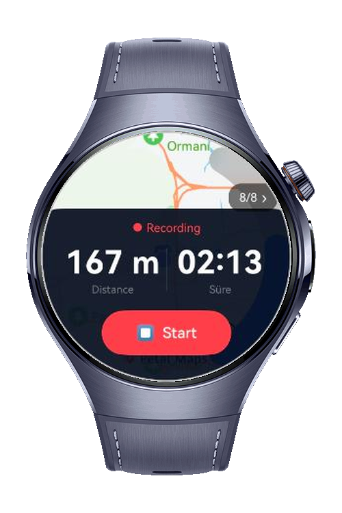
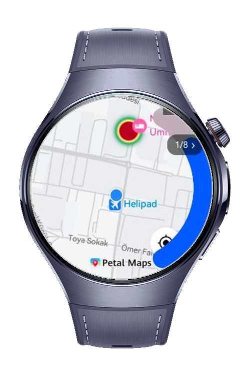
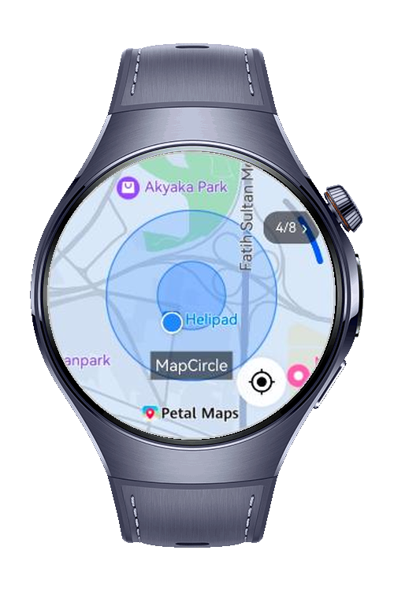

> **Note:** To access all shared projects, get information about environment setup, and view other guides, please visit [Explore-In-HMOS Index](https://github.com/Explore-In-HMOS/hmos-index).

# How To Build Heat Map Explorer

A HarmonyOS wearable application that demonstrates eight distinct map visualization modes using `@kit.MapKit` on a compact round watch UI. The app centers every visualization on the user's real GPS location and lets you cycle through all modes with a single tap.

# Preview

<p>
  
  
  
  
</p>

# Use Cases

- **Fitness on wrist:** Track a walk or run on the watch and see the live route, distance, and duration without pulling out a phone.
- **Heat zone exploration:** Visualize density hotspots (e.g. crowd, signal, training intensity) directly around the wearer's current location.
- **Quick POI marking:** Drop bubble or point annotations to flag spots while moving — useful for outdoor scouting, photography, or hiking.
- **Map-mode demo & learning:** Cycle through eight `@kit.MapKit` visualization modes on a real round watch face to evaluate which fits a given product.

# Technology

## Stack

- **Languages:** ArkTS, ArkUI
- **Frameworks:** HarmonyOS SDK 6.0.0(20)
- **Tools:** DevEco Studio Version 6.0.0
- **Libraries:**
  - `@kit.ArkUI`
  - `@kit.AbilityKit`
  - `@kit.BasicServicesKit`
  - `@kit.PerformanceAnalysisKit`

## Target APIs

- `MapComponent` → `MapComponent({ mapOptions, mapCallback })`
- `map` → `map.MapComponentController`
- `map` → `mapController.addHeatmap()`
- `map` → `mapController.addMarker()`
- `map` → `mapController.addCircle()`
- `map` → `mapController.addPolygon()`
- `map` → `mapController.moveCamera()` / `map.newCameraPosition()`
- `map` → `mapController.clear()`
- `map` → `mapController.setMyLocationEnabled()` / `setMyLocationControlsEnabled()`
- `map` → `map.TranslateAnimation`, `ScaleAnimation`, `RotateAnimation`, `AlphaAnimation`, `AnimationSet`
- `mapCommon` → `MapOptions`, `LatLng`, `WeightedLatLng`, `MarkerOptions`, `MapCircleOptions`, `MapPolygonOptions`
- `geoLocationManager` → `getCurrentLocation()`
- `geoLocationManager` → `on('locationChange')` / `off('locationChange')`
- `abilityAccessCtrl` → `createAtManager()`, `checkAccessToken()`, `requestPermissionsFromUser()`
- `bundleManager` → `getBundleInfoForSelf()`

## Required Permission

Declared in `module.json5`:

- `ohos.permission.INTERNET`
- `ohos.permission.LOCATION`
- `ohos.permission.APPROXIMATELY_LOCATION`

The app requests location permissions at runtime via `requestPermissionsFromUser()` and gracefully falls back if denied.

# Directory Structure

```text
entry/src/main/
├── ets/
│   ├── entryability/
│   │   └── EntryAbility.ets
│   ├── pages/
│   │   └── Index.ets
│   └── components/
│       ├── HeatmapPage.ets
│       ├── PointAnnotationPage.ets
│       ├── BubblePage.ets
│       ├── MapCirclePage.ets
│       ├── MapPolygonPage.ets
│       ├── AnimationPage.ets
│       ├── AlphaAnimationPage.ets
│       └── TrackPage.ets
└── resources/
    └── base/
        ├── element/
        │   ├── color.json
        │   ├── float.json
        │   └── string.json
        └── profile/
            └── main_pages.json
```

# Constraints and Restrictions

## Supported Devices

- Huawei Watch 5 (HarmonyOS API 20+)

# License

**Heat Map Explorer** is distributed under the terms of the MIT License.  
See the [LICENSE](LICENSE) for more information.